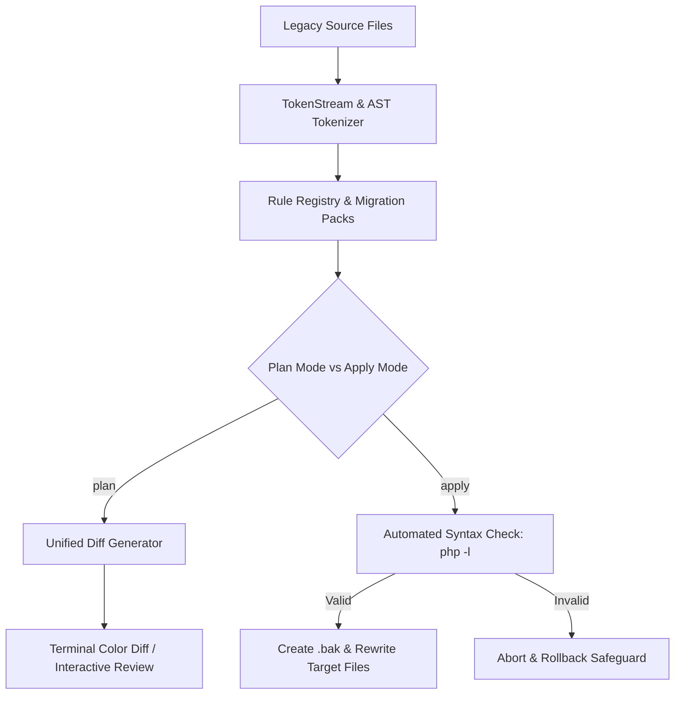

[🇸🇦 العربية](README.ar.md) | [🇬🇧 English](README.md)

# 🔄 eidcloud-code-migration

Universal AST-driven code migration and syntax transformation engine with style-preserving refactoring in pure PHP.

`eidcloud` `code-migration` `ast-refactoring` `syntax-transformation` `code-modernizer` `developer-tools` `php8`

---

[](https://github.com/eidcloud/eidcloud-code-migration/releases)
[](https://www.php.net/)
[](LICENSE)
[](https://colab.research.google.com/github/eidcloud/eidcloud-code-migration/blob/main/notebooks/quickstart.ipynb)

---

## 🌟 Overview

**`eidcloud-code-migration`** is an ultra-fast, zero-dependency AST/CST code transformation and modernization engine written entirely in modern PHP 8.2+. Unlike naive regex replacements or destructive AST printers, it retains comments, spacing, whitespace, and formatting while deterministically applying declarative language upgrades and architectural refactoring rules.



---

## 🚀 Key Features & Capabilities

- **Zero External Dependencies**: Pure native PHP 8.2+ implementation without third-party vendor bloat.
- **Token & Style Preservation**: Transforms code accurately while preserving surrounding comments, indentation, docblocks, and formatting.
- **Built-in Migration Packs**:
  - **`php84`**: Modernizes PHP 7.4/8.0 code to PHP 8.4 syntax:
    - Nullsafe operator (`$x !== null ? $x->foo() : null` $\rightarrow$ `$x?->foo()`)
    - Typed class properties (PHPDoc `@var type` $\rightarrow$ `private type $prop`)
    - Match expressions (`switch ($x) { case ... }` $\rightarrow$ `return match ($x) { ... }`)
  - **`mysqli`**: Transforms procedural `mysqli_*` calls into robust Object-Oriented `PDO` queries and statements.
  - **`callbacks`**: Modernizes single-expression closures into concise arrow functions (`fn(...) => ...`).
- **Interactive Unified Diff Generator**: Generates standard unified diffs (`--- a/`, `+++ b/`) with ANSI syntax color-coding for safe dry runs.
- **Automated Syntax Check Pre-flight**: Validates syntax (`php -l`) prior to persisting modifications on disk.
- **Safe In-Place Rollback**: Optional automatic creation of timestamped `.bak` backups before modifying any source file.

---

## 📦 Installation & Setup

Clone the repository or add it to your project:

```bash
git clone https://github.com/eidcloud/eidcloud-code-migration.git
cd eidcloud-code-migration
```

Verify your environment with the zero-dependency test runner:

```bash
php tests/run_tests.php
```

---

## 💻 CLI Usage

The CLI utility `bin/eidcloud-migrate` supports dry-run planning, rule filtering, and safe in-place transformations.

### 1. Dry Run / Planning (`plan`)

Inspect your legacy project without modifying any files and preview the diff:

```bash
# Preview all migrations
php bin/eidcloud-migrate plan ./my-project/

# Preview specific pack (e.g. PHP 8.4 upgrades)
php bin/eidcloud-migrate plan ./my-project/ --rule=php84

# Preview procedural MySQLi to PDO modernization
php bin/eidcloud-migrate plan ./src/Database.php --rule=mysqli
```

### 2. Applying Transformations (`apply`)

Execute the migrations with automated syntax validation and backup creation:

```bash
# Apply with automatic .bak backup files
php bin/eidcloud-migrate apply ./my-project/ --rule=php84 --backup

# Apply all migration packs
php bin/eidcloud-migrate apply ./legacy-app/ --rule=all --backup
```

### 3. CLI Help & Options

```bash
php bin/eidcloud-migrate --help
```

Output:
```
🔄 EidCloud Code Migration CLI v1.0.0
Universal AST Code Migration & Syntax Transformation Engine

USAGE:
  php bin/eidcloud-migrate <command> <path> [options]

COMMANDS:
  plan    Inspect code, generate AST migrations and output unified diff without modifying files
  apply   Perform AST migrations on target files with safety checks and optional backup

OPTIONS:
  --rule=<pack|id>  Rule selector or pack name (e.g. php84, mysqli, callbacks, all). Default: all
  --backup          Create .bak backup copies before modifying files (for apply command)
  --no-color        Disable ANSI color codes in terminal output
  -h, --help        Display this help message
```

---

## 🛠️ Programmatic Usage in PHP

You can integrate `EidCloud\CodeMigration\MigrationEngine` directly into your existing CI/CD pipelines or static analysis tools:

```php
<?php

use EidCloud\CodeMigration\MigrationEngine;

require_once __DIR__ . '/src/MigrationEngine.php';

$engine = new MigrationEngine();

// Plan migrations across a directory
$plan = $engine->plan('/path/to/legacy/code', 'php84');

echo "Found " . $plan->totalChanges . " modernization opportunities.\n";

foreach ($plan->filePlans as $filePath => $details) {
    echo "Diff for {$filePath}:\n";
    echo $details['diff'];
}

// Apply plan with backup safety
$result = $engine->applyPlan($plan, backup: true);
echo "Successfully modernized {$result['files_migrated']} files.\n";
```

---

## 🧪 Testing

Run the built-in test suite:

```bash
php tests/run_tests.php
```

All 30 unit tests evaluate token stream preservation, AST visitor traversals, diff formatting, rule sets, and file rollbacks.

---

## 📓 Interactive Quickstart Notebook

Try the Google Colab quickstart notebook:

[](https://colab.research.google.com/github/eidcloud/eidcloud-code-migration/blob/main/notebooks/quickstart.ipynb)

Located at [`notebooks/quickstart.ipynb`](notebooks/quickstart.ipynb).

---

## 👤 Author & Maintainer

**Eng. MHD. Shadi AL-Hasan**  
- **Role:** Executive CTO & Enterprise Solutions Architect  
- **Email:** [mhd.shadi.alhasan@gmail.com](mailto:mhd.shadi.alhasan@gmail.com)  
- **Phone / WhatsApp:** [+963934005922](tel:+963934005922)  
- **Location:** Damascus, Syria  
- **GitHub:** [shadialhasan](https://github.com/shadialhasan)  

---

## 📄 License

This project is licensed under the MIT License - see the [LICENSE](LICENSE) file for details.  
Copyright (c) 2026 **MHD. Shadi AL-Hasan**. All rights reserved.
